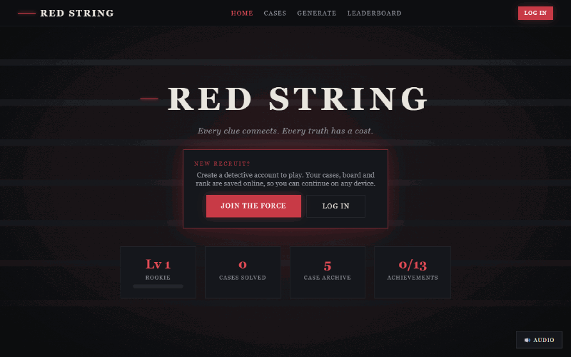
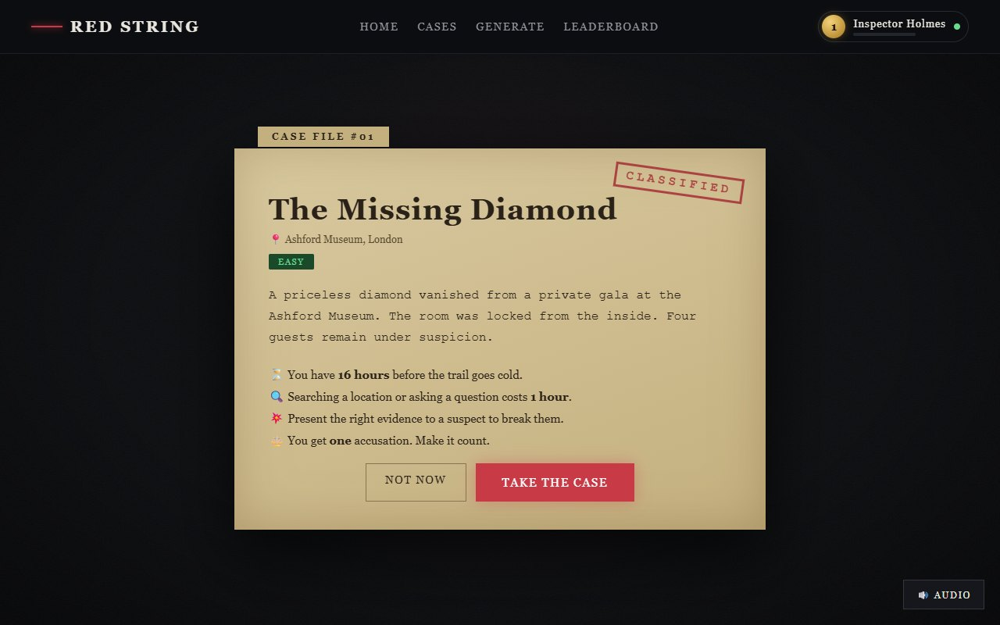
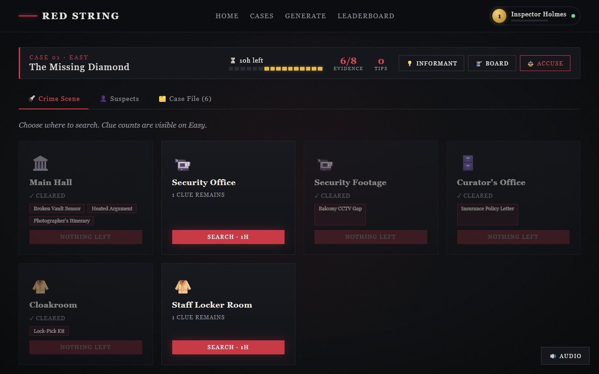
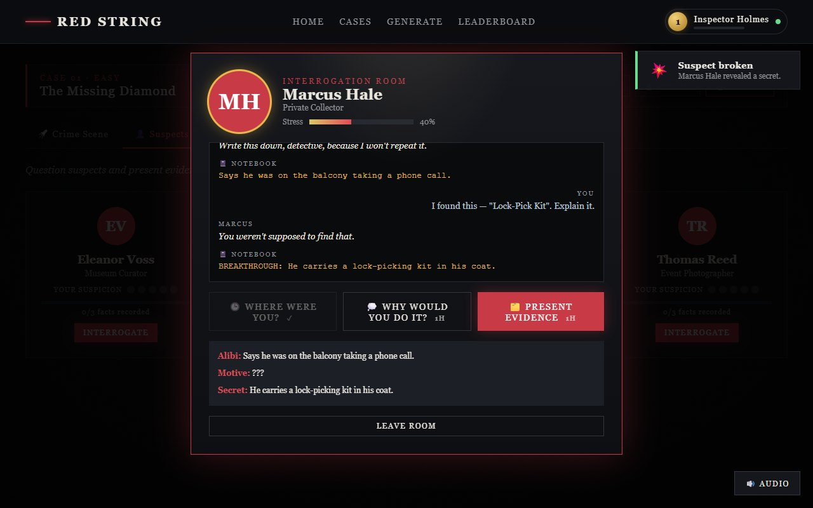
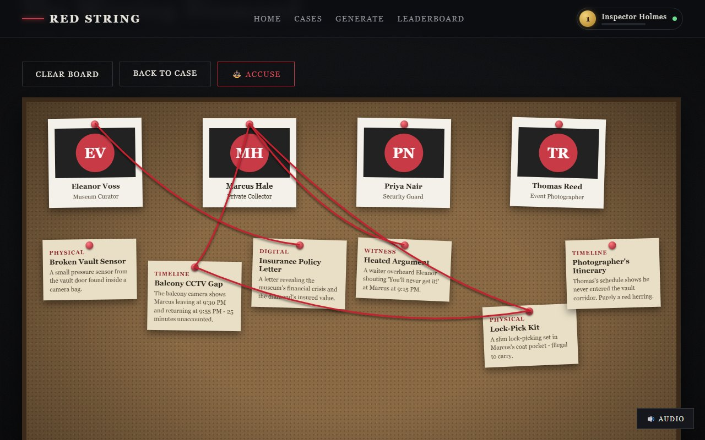
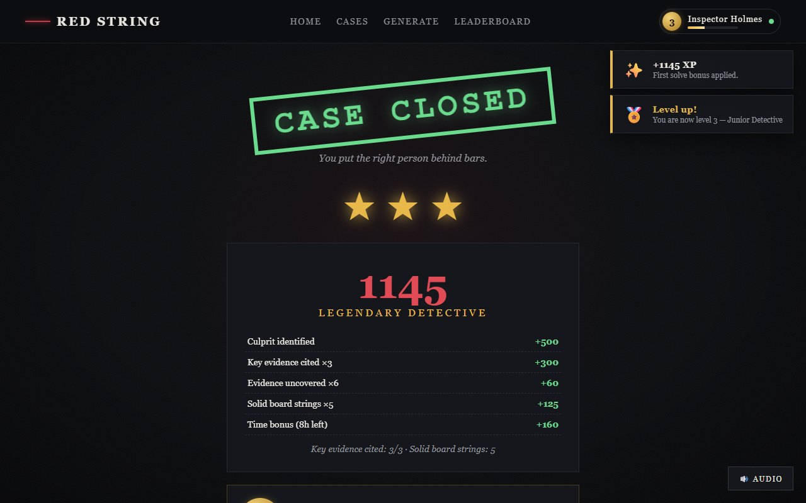
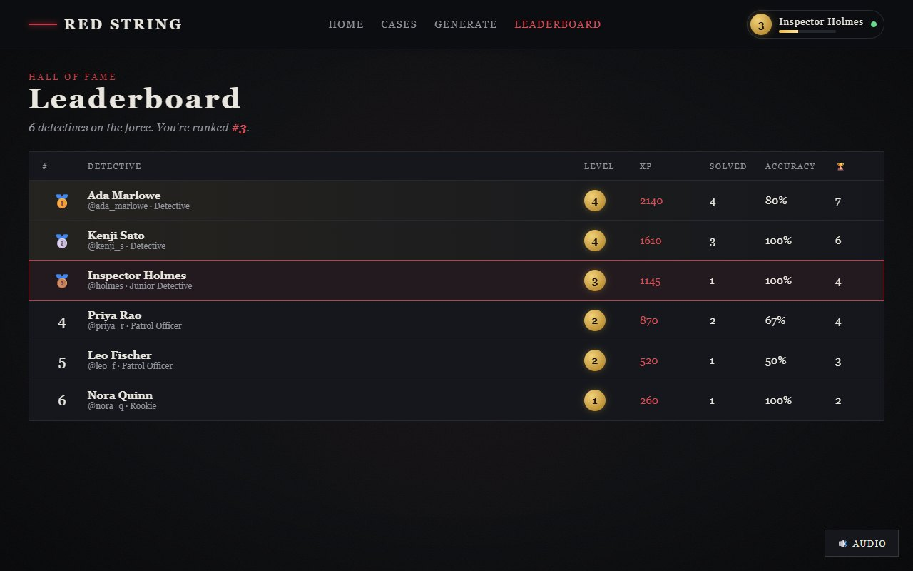
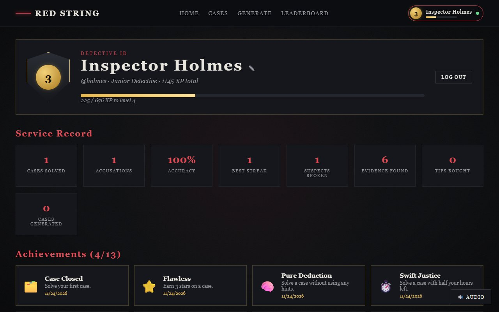
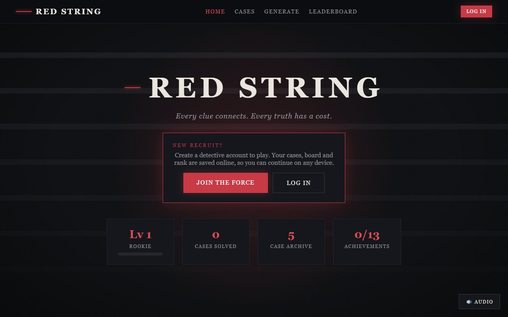
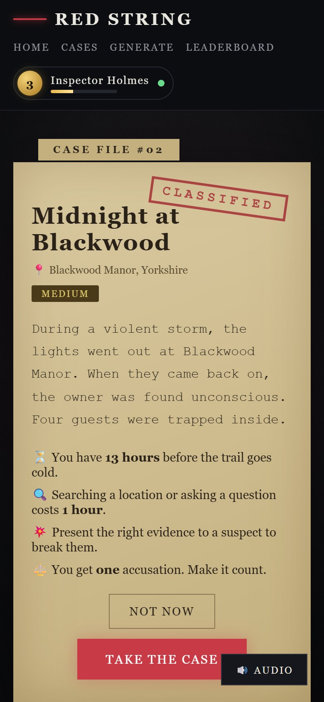

# 🕵️‍♂️ RED STRING — Detective Game

> **"Every clue connects. Every truth has a cost."**

## 🎮 Play Now

### 👉 **[https://red-string-7n2s.onrender.com/](https://red-string-7n2s.onrender.com/)**

Create a free detective account and play from any device. Your progress is saved online and you can climb the global leaderboard.

### 📱 Android app

**[⬇️ Download RED STRING for Android (APK)](https://github.com/Rahul022-rj/RED-STRING/releases/latest/download/red-string.apk)**

The app and the website share the **same server and database**: log in with the same account and your cases, board, XP and leaderboard rank stay in sync in both directions.

> Installing: open the downloaded file on your phone and allow "Install unknown apps" for your browser when Android asks.
> On iPhone, open the website in Safari → Share → **Add to Home Screen** to install it like an app.

> Hosted on Render's free plan: if nobody has played for a while, the first load can take 30–50 seconds while the server wakes up.

<p align="center">
  
</p>

---

## 📸 Screenshots

<table>
  <tr>
    <td width="50%"><br><b>Case briefing</b>: the file unfolds, the clock starts.</td>
    <td width="50%"><br><b>Crime scene</b>: spend hours searching locations for evidence.</td>
  </tr>
  <tr>
    <td><br><b>Interrogation</b>: present the right evidence to break a suspect.</td>
    <td><br><b>Corkboard</b>: tie suspects and clues together with red string.</td>
  </tr>
  <tr>
    <td><br><b>Verdict</b>: stamped result, stars and a server-scored breakdown.</td>
    <td><br><b>Leaderboard</b>: every detective ranked by XP (demo data).</td>
  </tr>
  <tr>
    <td><br><b>Profile</b>: level, service record and achievements.</td>
    <td><br><b>Home</b>: create an account and start investigating.</td>
  </tr>
</table>

<p align="center">
  <br>
  <b>Works on phones too.</b>
</p>

**RED STRING** is a complete, full-stack, interactive detective game. Players step into the shoes of an investigator to solve mysterious incidents by examining suspects, discovering hidden evidence, and connecting clues on an interactive virtual corkboard using red strings. Once they have a theory, they make an accusation and get scored based on their detective work.

The application features a Node.js/Express backend for game logic, API routing, and scoring, alongside a dynamic React/Vite frontend featuring a premium cinematic dark theme. It also includes an AI-powered Case Generator to create infinite new mysteries!

---

## ✨ Features

- **Ticking clock:** Every case gives you a budget of investigation hours (Easy 16h, Medium 13h, Hard 11h). Each search or question costs 1 hour. When time runs out, the trail goes cold and you must accuse.
- **Crime-scene exploration:** Evidence is hidden across locations. You pick where to search. On Medium and Hard you won't know a room is empty until you waste an hour finding nothing.
- **Interrogations:** Ask suspects for their alibi and motive, or present evidence. Show them the right clue and they break and reveal their secret. Show them the wrong clues too often and they lawyer up for good.
- **Corkboard:** Suspects and the evidence you've found are pinned on a cork board. Tie them together with sagging red strings, drag cards around, and click a string to cut it. Solid connections earn points.
- **One-shot accusation:** Name the culprit and cite up to 4 pieces of evidence you actually found. The server scores everything (culprit, key evidence, wrong evidence, board strings, time left, tips used) and awards 0–3 stars.
- **Cinematic verdict:** Suspense build-up, a stamped verdict, stars, a score count-up with a full breakdown, then the true solution.
- **Detective career:** Enlist with a name, earn XP, level up through ranks from Rookie to Living Legend, and unlock 13 achievements. Best scores and stars are kept per case.
- **Audio:** Procedural sound effects and an ambient rain-and-drone soundtrack, all synthesized with the Web Audio API (no audio files).
- **Case generator:** Generate unlimited playable cases from 8 settings, each with its own set of search locations (local template engine, or OpenAI if a key is configured).
- **Online accounts:** Register and log in (bcrypt-hashed passwords, JWT sessions). Your cases, notes, board, XP and achievements are stored in MongoDB, so you can continue on any device.
- **Global leaderboard:** Every player is ranked by XP. XP and scores are computed on the server from stored progress, so they can't be edited in the browser.
- **Shared case library:** Cases a player generates are saved to the database and playable by everyone, credited to their creator. Only the creator can delete them.
- **Solutions stay on the server:** Culprits and solutions never reach the client until you accuse.

---

## 🛠️ Tech Stack

**Frontend:**
- React.js (v18)
- Vite
- React Router (v6)
- Vanilla CSS3 (Custom properties, Flexbox/Grid)
- SVG for red string connections

**Backend:**
- Node.js + Express.js (REST API, also serves the built game in production)
- MongoDB + Mongoose (users, progress, boards, custom cases)
- bcryptjs + JSON Web Tokens (authentication), express-rate-limit (login protection)

---

## ⚙️ Prerequisites

Before you begin, ensure you have the following installed on your machine:
- **Node.js** (v18.0.0 or higher recommended) - [Download here](https://nodejs.org/)
- **npm** (comes packaged with Node.js)
- **Git** (for cloning the repository)
- **MongoDB**: either installed locally ([Community Server](https://www.mongodb.com/try/download/community)) or a free cloud database on [MongoDB Atlas](https://www.mongodb.com/atlas)

---

## 🚀 Installation & Setup

Follow these steps to run the project locally.

### 1. Clone the repository
```bash
git clone https://github.com/YOUR_USERNAME/RED-STRING.git
cd RED-STRING
```

### 2. Install dependencies
This project uses a root `package.json` to manage both the frontend and backend. Run the custom install script from the root folder:

```bash
npm install
npm run install:all
```
*(This installs the root `concurrently` dependency, the backend Express dependencies, and the frontend React/Vite dependencies in one go.)*

### 3. Configure the server
Copy `server/.env.example` to `server/.env` and fill it in:

```env
MONGODB_URI=mongodb://127.0.0.1:27017/redstring
JWT_SECRET=any-long-random-string
```

### 4. Start the application
Run the development server from the root folder:

```bash
npm run dev
```

### 5. Open the game
- **Frontend:** Open your browser and go to [http://localhost:5173](http://localhost:5173)
- **Backend API:** The Express server runs on [http://localhost:5000](http://localhost:5000)

---

## 🎮 How to Play

1. **Join the force:** Create an account (or log in). Anyone can browse cases and the leaderboard; playing needs an account.
2. **Take a case:** Pick a file in the Case Archive. Read the briefing, then click **Take the case** to start the clock.
3. **Crime Scene tab:** Search locations (1h each) to uncover evidence.
4. **Suspects tab:** Interrogate suspects (1h per question). Present evidence to break them. Watch their stress bar: at 100% they stop talking. Use the dots to mark how suspicious *you* think each one is.
5. **Board:** Open the board, click one card and then another to tie a red string. Strings that link evidence to the right suspect, or key evidence to key evidence, score points.
6. **Informant:** Stuck? Buy up to 3 tips. Each costs 100 points and stops you from earning 3 stars.
7. **Accuse:** Pick the culprit and cite up to 4 pieces of evidence. It's final, so make it count.

**Stars:** ★ correct culprit · ★★ plus every key piece of evidence cited · ★★★ plus no informant tips.

---

## 🌍 Deploy Online (play from anywhere)

In production the Express server hosts both the API and the built game, so the whole thing is **one web service with one URL**.

1. **Database:** Create a free cluster on [MongoDB Atlas](https://www.mongodb.com/atlas). Add a database user, allow network access from `0.0.0.0/0`, and copy the connection string (`mongodb+srv://...`). Put a database name in it, e.g. `.../redstring?retryWrites=true&w=majority`.
2. **Push** this repo to GitHub.
3. **Render:** On [render.com](https://render.com) choose **New → Blueprint** and select the repo. `render.yaml` sets everything up (build `npm run build`, start `npm start`, auto-generated `JWT_SECRET`).
4. When asked, paste your Atlas string as **`MONGODB_URI`**.
5. Open the `https://red-string-xxxx.onrender.com` URL and share it. (The official deployment is live at **https://red-string-7n2s.onrender.com/**.)

Any Node host works the same way (Railway, Fly.io, a VPS): run `npm run build`, then `npm start` with `MONGODB_URI`, `JWT_SECRET` and `NODE_ENV=production` set.

> Render's free plan sleeps after inactivity, so the first visit can take ~30–50 seconds to wake up.

### API overview

| Method | Path | Auth | Purpose |
|---|---|---|---|
| POST | `/api/auth/register`, `/api/auth/login` | – | Create account / log in, returns a token |
| GET | `/api/me/state` | ✔ | Profile + all progress + boards |
| PUT | `/api/me/progress/:caseId`, `/api/me/board/:caseId` | ✔ | Save investigation / board |
| DELETE | `/api/me/progress/:caseId` | ✔ | Reset a case |
| POST | `/api/game/accuse`, `/api/game/hint` | ✔ | Server-scored accusation, informant tips |
| POST/DELETE | `/api/generate` | ✔ | Generate / delete your custom case |
| GET | `/api/cases`, `/api/leaderboard` | – | Case archive, rankings |

---

## 📱 Building the Android App

The Android app is the same React game wrapped with [Capacitor](https://capacitorjs.com/). Its build points at the live server (`client/.env.app` → `VITE_API_URL`), so it uses the same database as the website.

Requirements: Android SDK (e.g. from Android Studio) and **JDK 21** (Gradle 8.14 can't run on Java 25).

```bash
cd client
npm run build:app            # build the web game for the app + copy it into android/
cd android
# Windows (PowerShell): $env:JAVA_HOME="C:\path\to\jdk-21"
./gradlew assembleDebug      # → android/app/build/outputs/apk/debug/app-debug.apk
```

Set `sdk.dir` in `client/android/local.properties` if Gradle can't find your Android SDK (e.g. `sdk.dir=D:/Android/SDK`).

**Publishing a new version:** on GitHub open **Releases → Draft a new release**, attach the APK renamed to **`red-string.apk`**, and publish. The download link on the website and in this README always points to the latest release.

App icons and splash screens are generated from `client/assets/` with `npx @capacitor/assets generate --android`.

---

## 🧠 Custom Case Generator

You can generate infinite new cases via the **Generate** page in the navigation bar.

**How it works:**
- **Default (Offline):** The backend uses a local template engine (`server/services/caseGenerator.js`) to mix and match locations, suspects, evidence, and solutions. This works 100% offline.
- **Real AI (Optional):** If you want to use OpenAI to write the case text dynamically, create a `.env` file in the `server/` directory and add your API key:
  ```env
  OPENAI_API_KEY=sk-your-api-key-here
  ```
  Restart the server. If the key is present, the backend will automatically use the OpenAI API instead of the local templates.

---

## 📁 Project Structure

```text
RED-STRING/
│
├── client/                 # React Frontend (Vite)
│   ├── src/
│   │   ├── components/     # UI pieces (Interrogation, HintSystem, Toasts, Typewriter, ...)
│   │   ├── game/           # Game systems: rules/levels/achievements, storage, sfx, events
│   │   ├── pages/          # Routes (Home, Cases, Investigation, Board, Results, Generate, Profile)
│   │   ├── services/       # API fetch helpers
│   │   ├── App.jsx         # Router configuration
│   │   └── style.css       # Global styling & themes
│   └── vite.config.js      # Vite proxy config to port 5000
│
├── server/                 # Node.js/Express Backend
│   ├── config/db.js        # MongoDB connection (+ one-time import of old customCases.json)
│   ├── controllers/        # auth, me (progress/leaderboard), game, generate
│   ├── data/               # cases.js (built-in cases)
│   ├── middleware/         # JWT auth, async error wrapper
│   ├── models/             # Mongoose: User, Progress, CustomCase
│   ├── routes/             # Express routers
│   ├── services/           # caseGenerator, caseStore, progression (scoring/XP/achievements)
│   └── server.js           # Express entry point
│
├── render.yaml             # One-click Render deployment
└── package.json            # Root scripts (dev, build, start, install:all)
```

---

## 🐛 Troubleshooting

- **"Could not connect to MongoDB":** Check `MONGODB_URI` in `server/.env`. Locally, make sure the MongoDB service is running. On Atlas, check the database user/password and that Network Access allows your IP (or `0.0.0.0/0` for cloud hosts).
- **Logged out unexpectedly:** Tokens last 30 days, and changing `JWT_SECRET` logs everyone out.
- **Port 5000 or 5173 already in use:** Ensure no other React or Node processes are running in the background. You can kill them using Task Manager or `npx kill-port 5000`.
- **Vite Proxy Errors:** Make sure the backend server is running in the `[0]` terminal tab. The frontend proxies `/api` requests to `http://localhost:5000`.
- **esbuild error on Windows:** If Vite fails to start, run `cd client && npm install-scripts approve esbuild && cd ..`, then try `npm run dev` again.
- **BOM errors (JSON parse errors):** If you manually edited JSON files in Windows PowerShell, they might contain a Byte Order Mark (BOM). Ensure you save them as UTF-8 without BOM.

---
*Created as a Full-Stack Mini Project. Enjoy the investigation!*